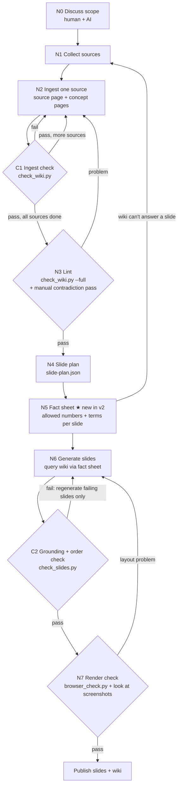

# Loop / graph design

## The graph (final version, v2)

In plain text:

**Get sources → ingest each one (check) → lint the wiki → plan slides → build a fact sheet from the wiki → generate slides → grounding/order check → render check → publish**

## What each node does

| Node | What happens | Tool / file |
|---|---|---|
| N0 Discuss | Agree on audience, 7 guiding questions, planned concept pages, source list, ground rules *before* generating anything | `process/00-discussion.md` |
| N1 Collect | Find and read sources; save a capture note per source (raw layer, never edited later) | `raw/*.md` |
| N2 Ingest | Write a source page; add cited bullets to concept pages (append-only, so earlier sources are never overwritten); update index + log | `tools/wiki_add.py`, `wiki/` |
| C1 Ingest check | Every citation points to a real source page; every link works; every Details bullet has a citation; **every Key number exists in the raw capture of the cited source** | `tools/check_wiki.py` |
| N3 Lint | Full check (orphans, sources feeding no concept, concepts with no Related links) + a manual read for contradictions between pages | `tools/check_wiki.py --full` |
| N4 Slide plan | Teaching order: which wiki pages each slide uses and which terms it defines | `process/slide-plan.json` |
| N5 Fact sheet | For each slide: the numeric facts it may use, the terms already defined, and the terms **not yet allowed** | `tools/make_factsheet.py` → `process/factsheet.md` |
| N6 Generate | Write the HTML slides using only the fact sheet / wiki pages; each slide declares `data-wiki` and `data-defines` | `slides.html` |
| C2 Grounding check | (a) each slide cites existing wiki pages; (b) every number on a slide is in a page it cites; (c) no term is used before the slide that defines it | `tools/check_slides.py` |
| N7 Render check | Headless Chrome: screenshot every slide, JS console errors, content overlapping the footer, broken wiki links. Then a human looks at the screenshots | `tools/browser_check.py` |

## Which steps repeat?
- **N2 → C1 runs once per source** (6 times here). The wiki grows one source at a time, and each ingest is checked immediately, so an error is caught while I still remember that source.
- **C1 → N2** repeats until the ingest check passes.
- **N3 Lint** runs after all ingests (and should run again after every few new sources).
- **C2 → N6** repeats until the grounding/order check passes; only the failing slides are regenerated, not the whole deck.
- **N7 → N6** repeats until the slides look right in a real browser.

## Where do we check / regenerate?
1. **C1 (after every ingest):** the wiki itself must be trustworthy, because it is the *only* knowledge source for the slides.
2. **N3 (lint):** some problems only appear between pages (e.g. "1000 steps" vs "50 or 100 steps"). A per-page check cannot see them.
3. **N5 (fact sheet, before generation):** prevents the generator from inventing numbers or using jargon too early.
4. **C2 (after generation):** catches whatever still slips through.
5. **N7 (render):** a slide can be factually correct and still unreadable.

## Why this design?
- **The wiki is the single source of truth.** The slide step never reads the raw sources or "memory". If the wiki can't support a slide, the loop goes back to N1 to ingest a new source instead of letting the AI make something up.
- **Check early, check cheap.** A wrong number caught at ingest costs one line to fix. The same number caught after it is on a slide, in a quiz and in the summary costs three fixes.
- **Machine checks for what is mechanical, human eyes for what is not.** Scripts are good at numbers, links and term order. Layout and "does this teach well" still need a person to look (see the N7 results in the run log).
- **Append-only ingest** (`wiki_add.py`) keeps the history of each source visible and prevents a later source from silently overwriting an earlier one. Conflicts are written down as ⚠️ notes instead.

## v1 → v2: what changed after the first run
v1 had no N5: the plan went straight from N4 to N6, and all slide checking happened at C2.
The first C2 run found 13 problems (see `run-log.md`), most of them invented or unsupported numbers and terms used too early.
So I **moved the check earlier** by adding N5 (fact sheet) between the plan and generation. See `reflection.md`.
